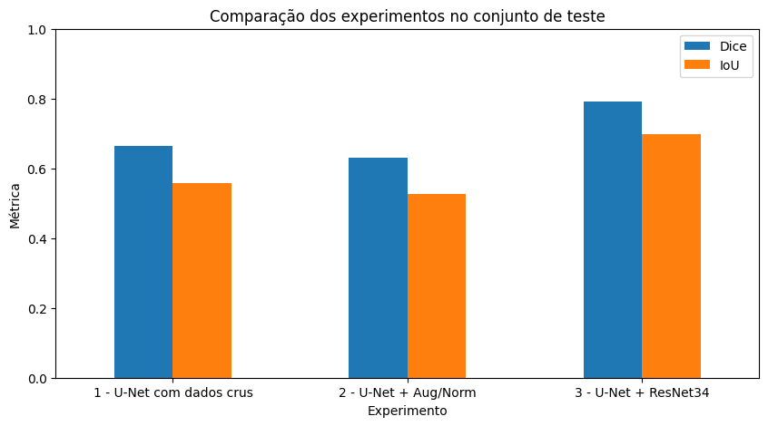
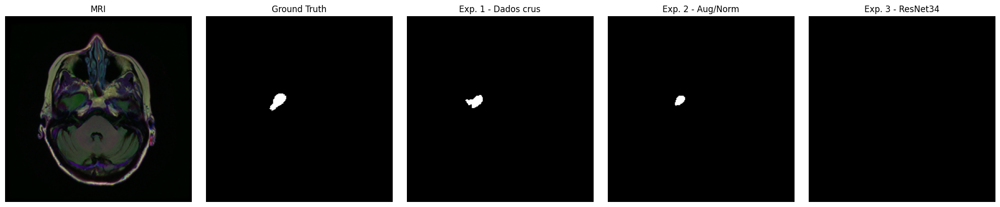

# Brain MRI Segmentation

## Sobre o projeto

Projeto acadêmico de Visão Computacional para **segmentar regiões tumorais em imagens de ressonância magnética cerebral**. Cada fatia do exame recebe uma máscara binária (tumor / não tumor), prevista pixel a pixel por redes U-Net em PyTorch.

Foram comparados três experimentos: uma U-Net simples com dados crus (baseline), a mesma U-Net com Data Augmentation e normalização ImageNet, e uma U-Net com encoder ResNet34 pré-treinado. O melhor resultado foi obtido pela **U-Net com ResNet34** (Dice 0,7908 e IoU 0,6992 no conjunto de teste).

## Dataset

[LGG MRI Segmentation — Kaggle](https://www.kaggle.com/datasets/mateuszbuda/lgg-mri-segmentation)

| Item | Valor |
|---|---:|
| Pacientes | 110 |
| Imagens | 3.929 |
| Máscaras | 3.929 |
| Resolução | 256 × 256 |
| Imagens com tumor | 1.373 (≈ 34,95%) |

O dataset é baixado em tempo de execução via `kagglehub` e não é versionado neste repositório.

## Preparação dos dados

Cada imagem foi associada à sua máscara e ao paciente correspondente, e as máscaras foram convertidas para valores binários (0/1).

A divisão foi feita **por paciente**, e não por imagem, para que fatias de um mesmo paciente não apareçam em conjuntos diferentes (evitando data leakage). O split usa `SEED = 42` e é o mesmo nos três experimentos.

| Conjunto | Pacientes | Imagens |
|---|---:|---:|
| Treino | 77 | 2.750 |
| Validação | 16 | 618 |
| Teste | 17 | 561 |

Os DataLoaders usam batch size 8.

## Experimentos

| Experimento | Configuração |
|---|---|
| 1 — Baseline | U-Net simples, dados crus, LR 1e-3 |
| 2 — Aug/Norm | Mesma U-Net + Data Augmentation + normalização ImageNet, LR 1e-3 |
| 3 — ResNet34 | U-Net com encoder ResNet34 pré-treinado no ImageNet (Transfer Learning), mesmo pipeline do Exp. 2, LR 1e-4 |

Todos utilizaram AdamW, perda `0,5 × BCEWithLogitsLoss + 0,5 × Dice Loss`, `ReduceLROnPlateau` e early stopping, com treinamento no Google Colab (GPU T4).

## Resultados

Conjunto de teste, usando o melhor checkpoint de cada experimento:

| Experimento | Test Loss | Dice | IoU |
|---|---:|---:|---:|
| U-Net com dados crus | 0.3916 | 0.6633 | 0.5570 |
| U-Net + Augmentation/Normalização | 0.4090 | 0.6303 | 0.5273 |
| U-Net + ResNet34 | **0.3591** | **0.7908** | **0.6992** |

Dice e IoU consideram apenas as imagens de teste com tumor (224). Valores também em [`results/experiment_comparison.csv`](results/experiment_comparison.csv).

- **Data Augmentation + normalização não melhoraram a U-Net simples**: Dice e IoU ficaram abaixo do baseline.
- **A U-Net com ResNet34 teve o melhor desempenho geral**, com a menor loss e os maiores Dice e IoU.
- Essa melhora **não pode ser atribuída exclusivamente ao augmentation**: o Experimento 3 também mudou a arquitetura, usou Transfer Learning e reduziu o learning rate.

## Visualizações





No exemplo exibido, a ResNet34 não detectou o tumor, enquanto os Experimentos 1 e 2 detectaram, mesmo sendo ela o melhor modelo nas métricas médias.

## Como executar

Recomendado: Google Colab com GPU.

1. Abra [`notebooks/Brain_MRI_Segmentation.ipynb`](notebooks/Brain_MRI_Segmentation.ipynb) no [Google Colab](https://colab.research.google.com/).
2. Ative a GPU em *Ambiente de execução → Alterar o tipo de ambiente de execução*.
3. Execute as células em ordem. As dependências são instaladas pelas próprias células (`!pip install`), e a lista completa está em [`requirements.txt`](requirements.txt).
4. O dataset é baixado automaticamente do Kaggle via `kagglehub`. Se for pedida autenticação, configure suas credenciais do Kaggle (nunca versione o `kaggle.json`).
5. Checkpoints e históricos são salvos no Google Drive e **não são versionados** neste repositório.

Para rodar localmente, instale o `requirements.txt` e substitua a montagem do Google Drive (seção 6.6.3 do notebook) por um diretório local.

## Estrutura do repositório

```
Brain-MRI-Segmentation/
├── README.md
├── LICENSE
├── requirements.txt
├── .gitignore
├── notebooks/   # Notebook completo
├── results/     # Métricas (CSV) e figuras
├── report/      # Relatório técnico (PDF)
└── pitch/       # Vídeo do pitch
```

## Materiais finais

- Relatório técnico: [`report/Relatorio_Tecnico_Brain_MRI_Segmentation.pdf`](report/Relatorio_Tecnico_Brain_MRI_Segmentation.pdf)
- Vídeo do pitch: [`pitch/pitch_final.mp4`](pitch/pitch_final.mp4)

## Autor

**Rafael Lazarin Lobo de Almeida** — GitHub: [github.com/RafaellLobo](https://github.com/RafaellLobo)

Licença: [MIT](LICENSE)

## Referência

- Dataset: Mateusz Buda. *LGG MRI Segmentation*. Kaggle. <https://www.kaggle.com/datasets/mateuszbuda/lgg-mri-segmentation>
- Artigo de origem: Buda, M.; Saha, A.; Mazurowski, M. A. *Association of genomic subtypes of lower-grade gliomas with shape features automatically extracted by a deep learning algorithm*. **Computers in Biology and Medicine**, v. 109, p. 218–225, 2019. DOI: [10.1016/j.compbiomed.2019.05.002](https://doi.org/10.1016/j.compbiomed.2019.05.002)
